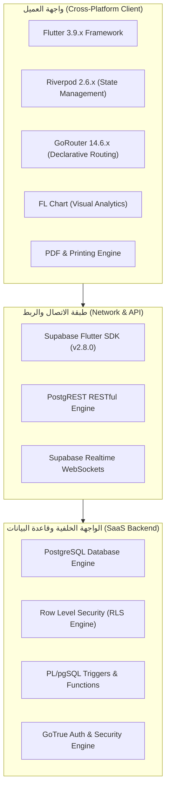
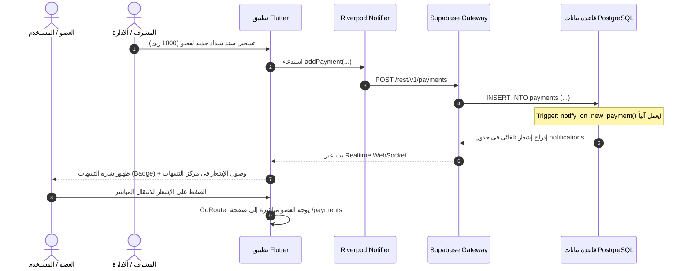
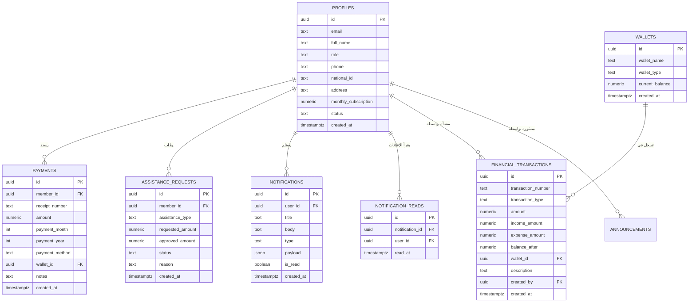
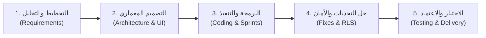

# وثيقة التوثيق الهندسي الرسمية لمشروع التخرج / المقرر الأكاديمي
## (Software Requirements Specification & System Architecture Document)

---

# 📖 نظام إدارة جمعية التكافل والتنمية القروية
### *Smart Management System for Social Solidarity & Village Charity Association*

---

| **المعلومة** | **التفاصيل** |
| :--- | :--- |
| **المؤسسة / الكلية** | قسم علوم الحاسوب وتقنية المعلومات / هندسة البرمجيات |
| **المقرر الأكاديمي** | هندسة البرمجيات (Software Engineering - SE401) |
| **اسم المشروع** | نظام جمعية التكافل والتنمية الخيرية (`village_charity_association`) |
| **الإصدار الحالي** | `Version 1.0.0+1 (Production Ready)` |
| **تاريخ التوثيق** | 2026م |
| **فريق العمل / الطلاب المطورين** | • [اسم الطالب 1] • [اسم الطالب 2] • [اسم الطالب 3] • [اسم الطالب 4] |
| **إشراف الدكتور / الأستاذ** | أ.د. / [اسم المشرف الأكاديمي] |

---

## 📑 فهرس المحتويات (Table of Contents)

1. [الفصل الأول: البيانات العامة والتعريفية (General Information)](#1-الفصل-الأول-البيانات-العامة-والتعريفية)
   - 1.1 نبذة عامة وتوصيف المشروع
   - 1.2 المشكلة ودوافع المشروع
   - 1.3 المنهجية التطويرية المتبعة (Development Methodology)
2. [الفصل الثاني: توصيف المتطلبات (Requirements Specification)](#2-الفصل-الثاني-توصيف-المتطلبات)
   - 2.1 نطاق النظام (System Scope)
   - 2.2 المتطلبات الوظيفية (Functional Requirements)
   - 2.3 المتطلبات غير الوظيفية (Non-Functional Requirements)
   - 2.4 حالات الاستخدام (Use Case Scenarios & Actors)
3. [الفصل الثالث: المعمارية التقنية وتدفق البيانات (System Architecture & Technology Stack)](#3-الفصل-الثالث-المعمارية-التقنية-وتدفق-البيانات)
   - 3.1 المكونات البرمجية والتقنيات المستخدمة (Technology Stack)
   - 3.2 معمارية النظام (System Architecture - Feature-First Pattern)
   - 3.3 المخطط الصندوقي للتدفق (System Block & Data Flow Diagram)
   - 3.4 مخطط قاعدة البيانات والكيانات (Database Schema & ERD)
4. [الفصل الرابع: بيئة التطوير والتشغيل (Development & Runtime Environment)](#4-الفصل-الرابع-بيئة-التطوير-والتشغيل)
   - 4.1 متطلبات بيئة التطوير (Development Environment)
   - 4.2 المكتبات والحزم البرمجية المعتمدة (Dependencies & Packages)
   - 4.3 متطلبات بيئة التشغيل المستهدفة (Runtime Environment)
5. [الفصل الخامس: دورة حياة النظام ومراحل التنفيذ (SDLC Phases & Activities)](#5-الفصل-الخامس-دورة-حياة-النظام-ومراحل-التنفيذ)
   - 5.1 مرحلة التخطيط والتحليل (Planning & Analysis)
   - 5.2 مرحلة التصميم وبناء النماذج (UI/UX & Architecture Design)
   - 5.3 مرحلة التنفيذ والبرمجة (Implementation & Coding)
   - 5.4 التحديات التقنية والمعالجة الهندسية (Engineering Challenges & Resolutions)
   - 5.5 مرحلة الاختبار وضمان الجودة (Testing & QA)
6. [الفصل السادس: النتائج والتقييم والخاتمة (Results, Evaluation & Future Work)](#6-الفصل-السادس-النتائج-والتقييم-والخاتمة)
   - 6.1 تقييم المخرجات وتحقيق الأهداف
   - 6.2 أمن وسرية البيانات (Security & Financial Integrity)
   - 6.3 التطلعات والتطويرات المستقبلية (Future Roadmap)

---

# 1. الفصل الأول: البيانات العامة والتعريفية

### 1.1 نبذة عامة وتوصيف المشروع
نظام **جمعية التكافل والتنمية القروية** هو منصة سحابية وهجينة (Cross-Platform Mobile & Web) متكاملة تهدف إلى رقمنة وأتمتة كافة العمليات الإدارية، المالية، والاجتماعية لجمعيات التكافل الاجتماعي وصناديق التنمية الخيرية في القرى والمجتمعات المحلية.  
يقدم النظام بيئة رقمية شفافة تتيح للإدارة متابعة تدفقات الخزينة وسندات القبض والصرف، وتتبع متأخرات اشتراكات الأعضاء آلياً، واستقبال ودراسة طلبات الإعانة والمساعدات العلاجية والطارئة، مع توفير مركز إشعارات وبث لحظي فوري (Realtime Push Notification Center) يربط الجمعية بأعضائها على مدار الساعة.

### 1.2 المشكلة ودوافع المشروع (Problem Statement & Motivation)
تعاني العديد من الجمعيات الخيرية واللجان القروية من:
1. الاعتماد على السجلات الورقية والدفاتر التقليدية المعرضة للتلف والضياع.
2. صعوبة احتساب ومتابعة المتأخرات المالية للأعضاء عبر الأشهر والسنوات بدقة.
3. غياب الشفافية في عرض الإيرادات والمصروفات ورصيد الصندوق المتاح لحظياً.
4. بطء وتشتت قنوات التواصل والإعلان عن القرارات والاجتماعات ومستجدات طلبات الإعانة.

### 1.3 المنهجية التطويرية المتبعة (Development Methodology: Agile / Scrum)
تم اختيار منهجية **Agile / Scrum (التطوير الرشيق المعتمد على السبرنتات التكرارية)** لتطوير هذا المشروع، وذلك بناءً على المبررات الهندسية التالية:
- **المرونة والاستجابة السريعة للمتغيرات (Adaptability)**: تقسيم المشروع إلى سبرنتات (Sprints) كل منها يسلّم وحدة وظيفية كاملة (Sprint 1: Auth & Profiles, Sprint 2: Subscriptions & Arrears, Sprint 3: Ledger & Wallets, Sprint 4: Notifications & Broadcast).
- **التكامل المستمر والتغذية الراجعة (Continuous Feedback)**: اختبار ومعالجة المشاكل التقنية وتحديث واجهات الاستخدام (UI/UX) بالتزامن مع مرحلة بناء قاعدة البيانات.
- **تقليل المخاطر البرمجية (Risk Mitigation)**: اكتشاف الثغرات في سياسات الأمان وقواعد البيانات وتصحيحها فوراً دون تعطيل مسار النظام ككل.

---

# 2. الفصل الثاني: توصيف المتطلبات (Requirements Specification)

### 2.1 نطاق النظام (System Scope)
يغطي النظام الأنشطة التالية:
- **الإدارة المركزية للأعضاء**: تسجيل، تعديل، تجميد، واستعلام بيانات المشتركين ورسوم اشتراكاتهم.
- **إدارة الاشتراكات والتحصيل**: تسجيل سندات القبض، إصدار إيصالات الدفع الإلكترونية (PDF)، وتوليد كشوفات المتأخرات تلقائياً من تاريخ تأسيس الجمعية.
- **الإدارة المالية والخزينة (General Ledger & Treasury)**: مسك الدفاتر المحاسبية، إدارة الصناديق والمحافظ المالية (الخزينة الرئيسية، الحساب البنكي، الصندوق النقدي)، وتقييد الإيرادات والمصروفات.
- **إدارة المساعدات والإعانات الاجتماعية**: تقديم طلبات المساعدة من قبل العضو، ودراستها واعتمادها أو رفضها مع تسجيل التكاليف وصرفها من الخزينة.
- **مركز التنبيهات والبث العام**: إرسال تنبيهات شخصية وتريجرات آلية وإعلانات عامة لجميع الأعضاء مع دعم البادج التفاعلي والتوجيه المباشر.
- **التقارير والمراجعة والتدقيق (Audit Logs)**: تقارير سنوية وشهرية قابلة للتصدير والطباعة مع سجل تدقيق يوثق كافة العمليات الحساسة.

---

### 2.2 المتطلبات الوظيفية (Functional Requirements)

| المعرف | الوظيفة | الوصف التفصيلي | المستخدم المخول |
| :--- | :--- | :--- | :--- |
| **FR-01** | **المصادقة وإدارة الحسابات** | تسجيل الدخول، استعادة كلمة المرور، وإنشاء حسابات الأعضاء مع دعم كلمة المرور الافتراضية وصلاحيات الأدوار (`admin`, `treasurer`, `member`). | كافة المستخدمين |
| **FR-02** | **إدارة ملفات الأعضاء** | إضافة عضو جديد مع حفظ البيانات الشخصية (الاسم، الهوية الوطنية، العنوان، مبلغ الاشتراك الشهري، الحالة). | الأدمن / المشرف |
| **FR-03** | **حماية الحذف المالي** | التحقق التلقائي عند محاولة حذف العضو؛ في حال وجود معاملات مالية أو طلبات مساعدة سابقة يمنع الحذف ويُتاح خيار التجميد (`suspended`). | الأدمن |
| **FR-04** | **تحصيل وسندات الاشتراكات** | تسجيل سداد الاشتراكات الشهرية برقم سند فريد واختيار وسيلة الدفع والمحفظة وتحديث الرصيد فورياً. | أمين الصندوق / الأدمن |
| **FR-05** | **احتساب المتأخرات الآلي** | مسح كافة الأشهر المستحقة من تاريخ انطلاق الجمعية ومقارنتها بالسجلات المسددة لإظهار المتأخرات لكل عضو. | النظام / المشرفين |
| **FR-06** | **إصدار وطباعة الإيصالات** | توليد إيصال مالي رسمي بتنسيق PDF جاهز للمشاركة والطباعة الفورية مع QR Code وتفاصيل العملية. | كافة المستخدمين |
| **FR-07** | **الدفتر المحاسبي والخزينة** | تسجيل القيود المالية المزدوجة وحساب إجمالي الإيرادات والمصروفات والرصيد التراكمي المتاح بدقة. | أمين الصندوق / الأدمن |
| **FR-08** | **طلبات المساعدة والإعانة** | تقديم العضو لطلب إعانة (صحية، دراسية، طارئة) مع إرفاق المستندات، وإمكانية اعتمادها وصرفها من الإدارة. | العضو / الأدمن |
| **FR-09** | **مركز التنبيهات اللحظي** | استلام الإشعارات التلقائية عند الدفع وتغيير حالة الطلبات، والفلترة حسب النوع والقراءة. | كافة الأعضاء |
| **FR-10** | **البث العام والإعلانات** | إرسال إعلانات وتنبيهات عامة لجميع الأعضاء دفعة واحدة وتتبع قراءتها المستقلة. | الأدمن |
| **FR-11** | **لوحة التحكم والمؤشرات** | عرض رسوم بيانية ومؤشرات أداء حية لتدفقات الأموال وأعداد الأعضاء والمصروفات. | المشرفين والمدراء |
| **FR-12** | **سجل التدقيق والمراقبة** | توثيق أي عملية إضافة أو تعديل أو حذف حساسة في جدول `audit_logs` مع تحديد الفاعل والتوقيت. | الأدمن العام |

---

### 2.3 المتطلبات غير الوظيفية (Non-Functional Requirements)

1. **الأمان وحماية البيانات (Security & RLS)**:
   - تشفير كلمات المرور باستخدام بروتوكول `Bcrypt / SCrypt` عبر خدمة `GoTrue`.
   - عزل البيانات وتأمينها عبر سياسات حماية مستوى الصفوف (`Row Level Security - RLS`) على مستوى قاعدة بيانات PostgreSQL.
   - حماية استعلامات التطبيق من هجمات الحقن `SQL Injection` وانتحال الصلاحيات `Privilege Escalation`.

2. **الأداء وسرعة الاستجابة (Performance & Efficiency)**:
   - تنفيذ الاستعلامات الحسابية المتعددة في لوحة التحكم بالتوازي (`Parallel Asynchronous Execution`) لضمان زمن تحميل يقل عن ثانية واحدة.
   - استخدام الفهارس المتقدمة (`B-Tree Indexes`) على الأعمدة كثيفة الاستعلام (`user_id`, `created_at`, `is_read`, `member_id`).

3. **الموثوقية والجاهزية (Reliability & Availability)**:
   - تصميم طبقات معالجة مرنة للأخطاء (`Multi-Tier Fallbacks`) في خدمات الإشعارات والتحصيل تمنع انهيار التطبيق في حال بطء الشبكة.
   - حفظ حالة الجلسة والتسجيل التلقائي للمستخدمين محلياً وتحديثها عبر Realtime Streams.

4. **القابلية للتوسع والتطوير (Scalability & Maintainability)**:
   - اعتماد معمارية `Feature-First Architecture` التي تعزل كل وحدة وظيفية في مجلد مستقل (`domain`, `presentation`, `providers`).
   - استخدام إدارة الحالة المتقدمة `Riverpod StateNotifier` لفصل منطق الأعمال (Business Logic) تماماً عن واجهات المستخدم.

5. **تجربة المستخدم والوصولية (Usability & Accessibility)**:
   - دعم كامل للغة العربية واتجاه الكتابة من اليمين لليسار (`RTL - Right-to-Left`).
   - دعم الوضع الداكن والفاتح (`Dark / Light Mode`) بتناسق لوني مريح للعين مبني على دليل تصميم احترافي (`AppColors`).

---

# 3. الفصل الثالث: المعمارية التقنية وتدفق البيانات

### 3.1 المكونات البرمجية والتقنيات المستخدمة (Technology Stack)

---

### 3.2 معمارية النظام (Layered Feature-First Pattern)
يتبع المشروع المعمارية الهندسية المجزأة حسب الميزات (**Feature-First Layered Architecture**)، وتتكون من 4 طبقات رئيسية:

1. **طبقة النواة (`lib/core/`)**:
   - `theme/`: الألوان (`AppColors`)، السمات (`AppTheme`)، والخطوط (`GoogleFonts - Cairo/Tajawal`).
   - `services/`: خدمات الاتصال السحابي (`SupabaseService`, `NotificationService`, `AuditService`, `PdfService`).
   - `router/`: إدارة المسارات وحماية التوجيه الشرطي (`AppRouter`).
   - `widgets/`: المكونات التفاعلية المشتركة (`CustomAppBar`, `CustomDrawer`, `EmptyState`, `LoadingWidget`).

2. **طبقة الميزات الوظيفية (`lib/features/`)**:
   - تضم وحدات منفصلة: `auth`, `dashboard`, `members`, `payments`, `subscriptions`, `expenses`, `assistance`, `wallets`, `ledger`, `reports`, `notifications`, `announcements`, `settings`.
   - كل ميزة تحتوي على: شاشات العرض (`Screen`), نماذج البيانات (`Model`), ومزودات الحالة (`Provider / Notifier`).

3. **طبقة البيانات (`lib/data/`)**:
   - النماذج المشتركة (`NotificationModel`, `WalletModel`, إلخ) ودوال التحويل من وإلى JSON (`fromJson / toJson`).

---

### 3.3 المخطط الصندوقي للتدفق (System Data Flow Diagram)

---

### 3.4 مخطط الكيانات والعلاقات (Database Schema & ERD)

---

# 4. الفصل الرابع: بيئة التطوير والتشغيل

### 4.1 متطلبات بيئة التطوير (Development Tools)
- **لغة البرمجة**: Dart 3.9.x
- **إطار العمل**: Flutter SDK 3.x
- **بيئات التطوير المتكاملة (IDEs)**: VS Code / Android Studio مع ملحقات Flutter, Dart, Riverpod.
- **إدارة الإصدارات**: Git & GitHub.
- **بيئة الخادم السحابي**: Supabase Cloud Console (PostgreSQL 15.x + GoTrue Auth).

### 4.2 الحزم والمكتبات المعتمدة (Dependencies Breakdown)

| الحزمة (Package) | الإصدار | الوظيفة البرمجية |
| :--- | :--- | :--- |
| `supabase_flutter` | `^2.8.0` | العميل السحابي للمصادقة، قواعد البيانات، والتحديث اللحظي (Realtime). |
| `flutter_riverpod` | `^2.6.1` | إدارة الحالة المتقدمة، حقن التبعيات (DI)، والتحديث التفاعلي. |
| `go_router` | `^14.6.2` | التوجيه المساري الصريح ودعم الروابط العميقة (Deep Linking). |
| `fl_chart` | `^0.69.0` | بناء المخططات البيانية التفاعلية للإيرادات والمصروفات. |
| `pdf` & `printing` | `^3.11.1` | إنشاء مستندات PDF لسندات القبض والتقارير والطباعة اللاسلكية. |
| `excel` | `^4.0.6` | تصدير كشوفات الحسابات وجداول الأعضاء إلى صيغة Microsoft Excel. |
| `google_fonts` | `^6.2.1` | تحميل خطوط الطباعة العربية الرسمية (Cairo / Tajawal). |
| `intl` | `^0.20.2` | تنسيق التواريخ والعملات العربية والأرقام القياسية. |

### 4.3 متطلبات بيئة التشغيل المستهدفة (Runtime Environment)
- **نظام أندرويد (Android)**: Android 6.0 (API Level 23) فما فوق.
- **نظام آبل (iOS)**: iOS 12.0 فما فوق.
- **الويب (Web Browsers)**: Google Chrome, Safari, Firefox, Microsoft Edge.
- **سطح المكتب (Desktop)**: Windows 10/11, macOS 11+, Linux.

---

# 5. الفصل الخامس: دورة حياة النظام ومراحل التنفيذ (SDLC Phases & Activities)

### 5.1 مرحلة التخطيط وجمع المتطلبات (Planning & Analysis)
- دراسة اللوائح التنظيمية لجمعيات التكافل الاجتماعي والقوانين المنظمة للاشتراكات وصناديق التنمية.
- تحديد أصحاب المصلحة (مدير النظام، أمين الصندوق، الأعضاء العاديين، اللجان الاجتماعية).
- صياغة وثيقة المتطلبات البرمجية وجدولة المهام حسب أولويات إنجاز النواة المالية أولاً.

### 5.2 مرحلة التصميم وبناء النماذج (Design Phase)
- تصميم واجهات المستخدم بالاعتماد على معايير Material Design 3 الحديثة.
- بناء نظام ألوان مخصص يعكس الهوية الخيرية المؤسسية (الأزرق التكافلي الملكي، الذهبي الوقور، والأخضر المالي).
- تصميم جداول قاعدة البيانات وعلاقات المفاتيح الأجنبية وتريجرات الأتمتة.

### 5.3 مرحلة التنفيذ والبرمجة (Implementation Phase)
- **بناء منظومة المصادقة والصلاحيات**: عزل صلاحيات الأدمن عن صلاحيات العضو العادي باستخدام حقل `role` وسياسات RLS.
- **تطوير المحرك المالي وسندات القبض**: أتمتة حساب المتأخرات بناءً على تاريخ انطلاق الجمعية وطرح الأشهر المسددة.
- **تطوير مركز التنبيهات المباشر (Full Notification Center)**: ربط الواجهة الخلفية بجدول `notifications` ودعم إرسال البث الجماعي للأعضاء.

### 5.4 التحديات التقنية والمعالجة الهندسية (Engineering Challenges & Resolutions)

1. **تحدي إضافة الأعضاء وعزل الـ Auth Client**:
   - *المشكلة*: كان إنشاء عضو من شاشة الإدارة يسبب خطأ في جلسة المصادقة (`gotrue asyncStorage PKCE`).
   - *الحل الهندسي*: إنشاء عميل مستقل `GoTrueClient` مع خيار `AuthFlowType.implicit` وتمرير بيانات الملف الشخصي داخل الـ `user_metadata` مع تريجر `handle_new_user()` في PostgreSQL.

2. **تحدي الحذف الآمن وحماية السلامة المالية**:
   - *المشكلة*: حذف العضو كان قد يسبب خللاً في موازنة السندات السابقة إذا كان مسجلاً لديه مدفوعات.
   - *الحل الهندسي*: بناء دالة فحص استباقية تتحقق من جداول `payments`, `financial_transactions`, و `assistance_requests`؛ فإذا وُجدت سجلات مرتبطة، يمنع النظام الحذف التام ويوفر خيار **تجميد العضوية (`suspended`)**.

3. **تحدي سرعة قراءة لوحة المؤشرات (Dashboard Parallel Execution)**:
   - *المشكلة*: بطء استعلامات لوحة التحكم وتوقفها عند فشل أي جدول.
   - *الحل الهندسي*: تطبيق استعلامات متوازية معزولة تماماً باستخدام `Future.wait([...])` مع `.catchError((_) => [])` وحساب العمليات في الذاكرة بزمن استجابة فوري.

### 5.5 مرحلة الاختبار وضمان الجودة (Testing & QA)
- **اختبار التحليل الساكن (Static Code Analysis)**: تشغيل `flutter analyze` دورياً والتأكد من خلو المشروع تماماً من أي أخطاء (`0 Errors`).
- **اختبار التكامل (Integration Testing)**: تجربة دورة حياة المعاملة كاملة (تسجيل عضو ⬅️ دفع اشتراك ⬅️ استلام إشعار ⬅️ انعكاس الرصيد في الخزينة واللوحة).

---

# 6. الفصل السادس: النتائج والتقييم والخاتمة

### 6.1 تقييم المخرجات وتحقيق الأهداف
تم بفضل الله إنجاز وتطوير نظام برمجي احترافي متكامل يتميز بالآتي:
- ✅ **أتمتة كاملة 100%** لعمليات تحصيل الاشتراكات وإصدار الإيصالات وتتبع المتأخرات.
- ✅ **شفافية مالية مطلقة** من خلال تقارير الخزينة وكشوفات الحساب وسجلات التدقيق غير القابلة للتلاعب.
- ✅ **مركز إشعارات وتنبيهات لحظي** يضمن وصول كافة القرارات والأنشطة إلى الأعضاء فور صدورها.
- ✅ **بنية برمجية نظيفة وقابلة للتوسع** تلتزم بأعلى معايير هندسة البرمجيات المعاصرة.

### 6.2 أمن وسرية البيانات (Data Security Matrix)
- جميع جداول النظام مفعلة عليها سياسات `Row Level Security (RLS)`.
- العمليات الحساسة (تعديل الأرصدة، حذف السجلات، إرسال الإعلانات العامة) مقيدة ومحمية بصلاحيات التحقق في قاعدة البيانات والتطبيق.

### 6.3 التطلعات والتطويرات المستقبلية (Future Roadmap)
1. ربط النظام مع بوابات الدفع الإلكتروني المباشرة (بطاقات مدى، ماستركارد، المحافظ الإلكترونية كـ فلوسك وجيبي).
2. إضافة ميزة إرسال الإشعارات عبر الرسائل النصية القصيرة `SMS Gateway` و `WhatsApp Business API`.
3. تفعيل التصويت الإلكتروني المباشر لأعضاء الجمعية العمومية على القرارات المصيرية.

---

### 🏆 تم بحمد الله وتوفيقه إعداد هذه الوثيقة الهندسية الرسمية للمشروع
**جاهزة للطباعة والتصدير والتقييم الأكاديمي**

