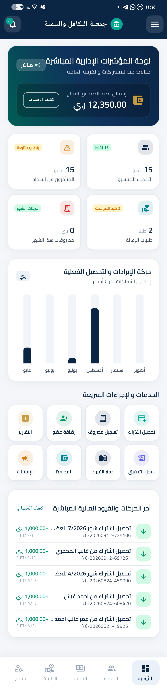
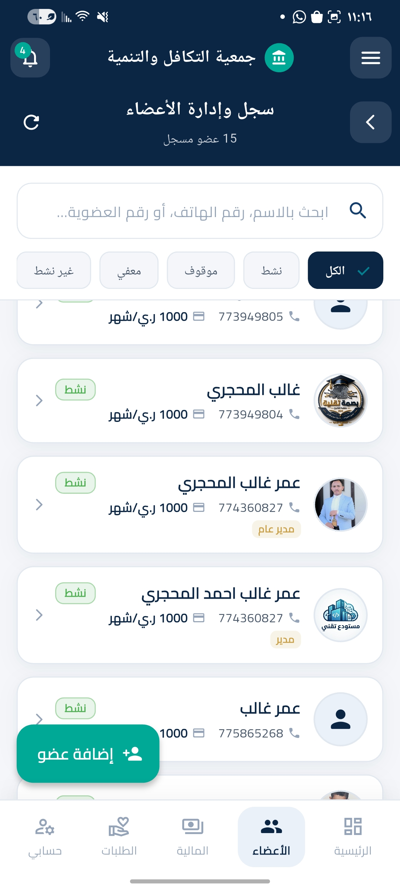
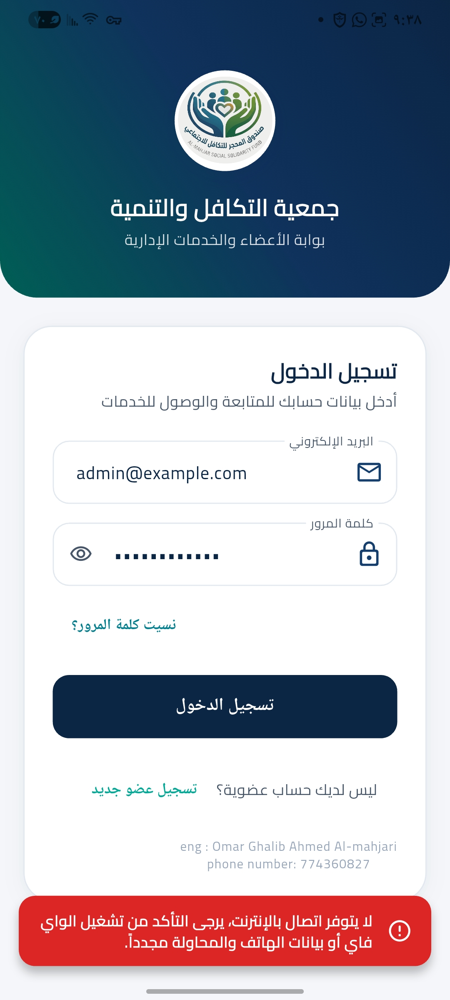
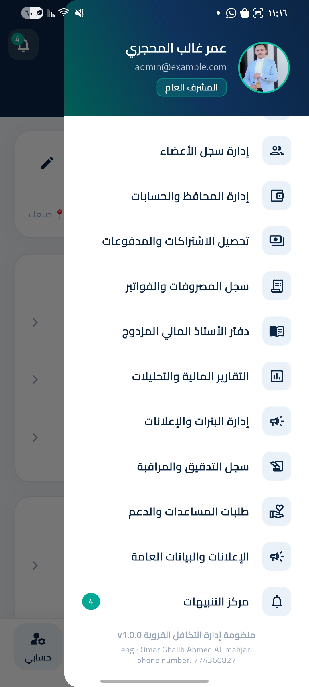

# نظام إدارة جمعية التكافل والتنمية القروية

مشروع تطبيق لإدارة أعمال جمعية التكافل والتنمية القروية، صُمّم لتنظيم بيانات الأعضاء والاشتراكات والدفعات وطلبات المساعدة والسجل المالي ضمن واجهة عربية تدعم اتجاه الكتابة من اليمين إلى اليسار (RTL).

> هذا المستودع لعرض المشروع ضمن ملف الأعمال، وليس دليلًا لتنزيل التطبيق أو تشغيله.

## صور من التطبيق

أضف لقطات الشاشة إلى مجلد `screenshots/` في جذر المستودع. بعد إضافة الصور، أزل التعليق عن الأسطر المناسبة لعرضها في صفحة المشروع:

## أبرز الميزات

- إدارة الأعضاء وبياناتهم.
- متابعة الاشتراكات والدفعات.
- إدارة طلبات المساعدة.
- عرض السجل المالي وحركاته.
- إنشاء سندات الدفعات وتحديث تغطية الأشهر وحركة السجل والإشعارات عبر دوال قاعدة البيانات.
- تصدير التقارير إلى PDF وExcel ومشاركة الملفات.
- واجهة عربية تدعم RTL.

## التقنيات المستخدمة

- **Flutter وDart** لبناء واجهة التطبيق.
- **Supabase وPostgreSQL** للمصادقة والبيانات ودوال قاعدة البيانات.
- **Riverpod** لإدارة الحالة، و**GoRouter** للتنقل.
- حزم للرسوم البيانية، وتصدير PDF وExcel، ومشاركة التقارير، والتعامل مع الصور والاتصال.

## عن المشروع

يعرض هذا المشروع تجربة بناء تطبيق إداري عربي يربط بين واجهة متعددة الصفحات وخدمات خلفية، مع تنظيم عمليات الدفعات والسجل المالي من خلال دوال قاعدة البيانات.
